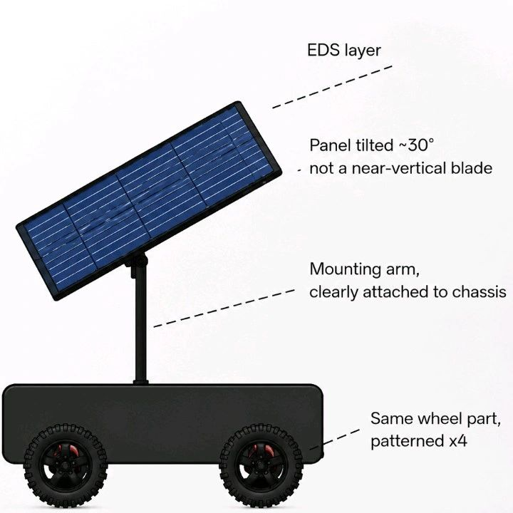

# STRATOS Lunar Project - Electrodynamic Dust Shield (EDS) Activation Control

Smart activation system for NASA's Electrodynamic Dust Shield (EDS), built during a 5-day engineering challenge with STRATOS. Lunar dust is abrasive and electrostatically charged; it accumulates on rover solar panels and reduces power output. The EDS can clear it - this project decides WHEN to activate it.

## What it does

- Focuses on the decision layer around the shield rather than redesigning it: when should the EDS activate?
- Uses two measurements already available on the rover - light intensity and solar panel power output - and fuses them with a Kalman Filter to estimate dust coverage.
- Triggers the EDS when the estimated coverage reaches the defined threshold.

## Results

- ~60% improvement in estimation accuracy compared with using a single sensor.
- Activation timing consistent with the physical model.
- Strong potential for reducing energy consumption compared with continuous EDS operation.

## Role

Sensor fusion lead on a four-person team (simulation, physical model, CAD, fusion): designed the Kalman Filter fusion of the two measurements and the activation-decision logic.

## Tools & stack

- MATLAB (simulation)
- Kalman Filter sensor fusion
- Light-intensity and solar-panel power measurements

## Links

- Project post: https://www.linkedin.com/posts/aya-mubarak-829862298_aerospaceengineering-lunarexploration-activity-7504239973152276480-vQ4V

## Status

README and project image first; simulation code and results plots can be added later.
